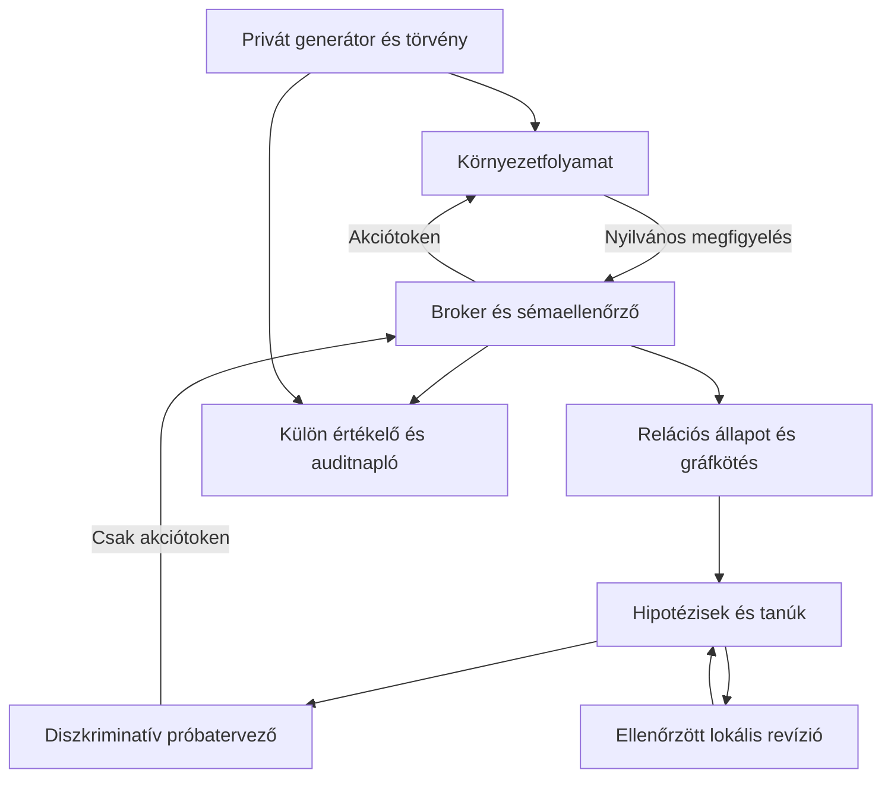

# Athlesia: ellenőrizhető akciómodell-tanulás és relációs transzfer

Dátum: 2026-10-13. A „megvalósított” állítások kizárólag a csomagban szereplő kódra vonatkoznak. A további hatnapos munkaterv nem kész funkciók felsorolása.

## 1. Tudományos audit és az állítás pontosítása

Az ILP, az akciómodell-tanulás, a cáfolatra történő elméletrevízió és a strukturális megfeleltetés metszete megalapozott kutatási irány. Ezek megléte nem jelenti, hogy egy új rendszer ezen fogalmak együttes használatától világelső.

| Elsődleges előzmény | Mit mutat? | Athlesia megkülönböztetése és korlátja |
|---|---|---|
| Rodrigues et al., *Active learning of relational action models* (ILP 2011) | STRIPS-szerű relációs szabályok online tanulása, váratlan hatások miatti revízió és aktív akcióválasztás. | Ez közvetlen előzmény. Az aktív relációs revíziót nem nevezhetjük saját első találmánynak. |
| Juba, Le, Stern, *Safe Learning of Lifted Action Models* (KR 2021) | Lifted, változókat használó akciómodellek tanulása és feltételes biztonsági garanciák. | A formális garanciák feltételeit nekünk is ki kell mondani. A mostani ideiglenes, általánosított modell hibázhat; nem SAM-biztonságú ágens. |
| Balloch et al., *Neuro-Symbolic World Models for Adapting to Open World Novelty* (2023), WorldCloner | Szimbolikus átmenetmodell, újdonságdetektálás és gyors adaptáció neurális policyvel. | Az Athlesia referencia nem tartalmaz neurális policyt. Az egylépéses szimbolikus adaptáció önmagában nem új. |
| Zhao et al., *Neuro-Symbolic Synergy for World Modeling* (2026), NeSyS, v4 | LLM és végrehajtható szimbolikus szabályok együttműködése, váltakozó tanítás és szabályalapú jelöltpontozás. | Itt nincs ilyen modell vagy tanítás. Ez erőforrás- és feltételrendszerbeli különbség, nem ugyanazon benchmarkon kimért fölény. |
| Liu et al., *LLM+P* (2023) | Nyelvi leírás PDDL-re fordítása, klasszikus tervező, visszafordítás. | A mi feladatunk az ismeretlen feltétel azonosítása. A helyesen megadott modellből történő CPU-tervezés önmagában már ismert erős megoldás. |

Források:

1. https://www-lipn.univ-paris13.fr/~rodrigues/Rodrigues_ilp2011.pdf
2. https://arxiv.org/abs/2107.04169
3. https://arxiv.org/abs/2301.06294
4. https://arxiv.org/abs/2602.10480v4
5. https://arxiv.org/abs/2304.11477

Ez célzott szakirodalmi audit, nem teljes szabadalmi vagy elsőbbségi kutatás. A felsorolt munkák eltérő feladatokra vonatkoznak; nincs összehasonlítható SOTA-pontszám a mostani fixture-re.

**Jelenleg megvédhető állítás:** előre deklarált, determinisztikus, instrumentált Boolean világcsaládban, neurális súlyok nélkül működő referenciaágens explicit hipotézishalmazzal, választott beavatkozásokkal és megőrzött ellenpéldákkal képes egy hiányos akciószabályt javítani; majd azonos mechanizmusú, egyértelműen izomorf, új tokenekkel leírt környezetben a változatlan szabályt végrehajtani. A teljes bemeneti szerződés, keresési korlát és mért költség publikálható.

**Nem megvédhető ebből:** világelsőség; általános emberi intelligencia; tetszőleges új fizika zero-shot megértése; minden LLM számára megoldhatatlanság; korlátlan tanulás fix memórián; feltétel nélküli one-shot pontosság; szubmilliszekundumos teljes futás; robotikában igazolt alkalmazhatóság.

## 2. Információs feltételek

Ha két modell az eddigi összes megfigyelésre ugyanazt jósolja, az adatok alapján nem választhatók biztosan szét. Az egyszerűbb modell előnyben részesítése hasznos preferencia, nem bizonyíték.

Ugyanez az átnevezett akciókra: két azonosan látszó vezérlő felcserélt belső hatása ugyanazt a kezdeti megfigyelést adhatja, miközben különböző helyes első akciót követel. Egy determinisztikus ágens mindkét esetben ugyanazt az akciót választaná, tehát nem lehet mindkettőben garantáltan helyes. Megfigyelhető megkülönböztetés, korábbi közös szerződés vagy kísérlet szükséges.

A referencia ezért deklarálja:

- Az objektum-/akció-/állapotcsatorna-típusok és a nyilvános kapcsolatok megfigyelhetők.
- Az objektum- és akcióazonosítók jelentés nélküli tokenek. A relációtípusok közös API-szókészletet alkotnak.
- A beállító beavatkozásokról tudjuk, melyik állapotcsatornát milyen értékre állítják; e nyilvános szerződést a futtató minden használatnál ellenőrzi.
- A feladatakció hatása és annak előfeltétele ismeretlen; ezt a solver nem kapja meg.
- A törvény stacionárius egy kísérleten belül. A hiányzó előfeltétel felismerése modelljavítás, nem időben önkényesen átváltó fizika kezelése.
- Az induló forrás- és céltopológia izomorf. A geometria kozmetikai: nem része a hatást meghatározó fizikának.
- A nem izomorf új feladat, új predikátum, részben megfigyelhetetlen állapot vagy új akciótípus külön fejlesztési feladat.

## 3. Architektúra és bizalmi határ



A privát generátor nincs a solver folyamatába importálva, a solver induló könyvtárában sem szerepel. A broker nem tervezi meg a javító akciót: kizárólag a tanuló által kért tokeneket továbbítja. A privát tesztkonfiguráció az environment külön induló csatornáján érkezik. A publikált riport ismerheti a seedet, a solver megfigyelése nem.

Az egyetlen környezeti metódus:

```python
class ActionPort(Protocol):
    def send_action(self, action_token: str) -> Observation: ...
```

Az `@observe` rezervált, nem módosító protokollművelet a kezdeti megfigyeléshez. Ezt is külön számoljuk. A többi token átlátszatlan. A visszatérő megfigyelés kizárólag epizódazonosítót, sorszámot, megfigyelhető gráfot, elrendezést és Boolean csatornaértékeket tartalmaz.

Tiltott többletmező, duplikált JSON-kulcs, hiányzó érték, nem véges szám, hibás típus, túl hosszú token, duplikált vagy lógó gráfél, túlméretes üzenet és epizódok közti/stagnáló sorszámú átmenet elutasításra kerül. Külső bemenet nem kerül `eval`, `exec` vagy pickle feldolgozásba.

A külön folyamat és Python `Protocol` nem rosszindulatú kód elleni sandbox. A mellékelt Docker-mód külön, hálózat nélküli, read-only, nem root solver image-et futtatna; ezt a jelenlegi futtatóhelyen nem tudtuk ellenőrizni. A hermetikus/adversariális izoláció állítása addig nyitott elfogadási kapu.

## 4. A matematikai mag

### 4.1. Állapot, szabály és hatásindukció

Legyen `O` az objektumok halmaza, `F` a megfigyelhető, földelt Boolean fluensek halmaza. Az állapot `s: F -> {0,1}`. A nyilvános strukturális gráf `G=(V,E,type)` tartalmazza az objektumokat, állapotcsatornákat, akciókat és a típusozott kapcsolatokat.

Egy általános STRIPS-szerű szabály:

\[
r=(a(\bar x),P_{static},P^+,P^-,Add,Del).
\]

Alkalmazható, ha a kötés teljesíti a statikus relációkat, a pozitív literálok igazak, a negatívak hamisak. Ekkor

\[
T_r(s,a)=(s\setminus Del)\cup Add.
\]

A referencia ennél szűkebb, teljes Boolean értékelést használ: `Literal(role,value)`, `Rule(action,context,guards,effects)`. A `context` a gráfkötéssel ellenőrzött statikus reláció; a `guards` dinamikus literálok konjunkciója; az `effects` explicit érték-hozzárendelések. A többi fluent változatlan marad. Ha a guard nem teljesül, a feladatakció no-op.

Sikeres nyomvonalból a pozitív hatásjelölt `s'\s`, a negatív `s\s'`. A kód a megfigyelt azonos akcióhoz tartozó delták közös részéből indul, majd az egész normalizált átmenet egyezését ellenőrzi. Nemuniform hatásoknál a jelenlegi modellnyelv kibővítését kéri, nem talál ki egy magyarázatot.

Az `?v0`, `?v1`, ... belső változónevek. Nem az azonosítók szövegéből következtetünk arra, melyik a gomb vagy az áramforrás. A tokenek csak a megfigyelésben szereplő csomópontokat nevezik meg.

### 4.2. Hipotézishalmaz és cáfolat

Legyen `H` a deklarált szabálynyelv véges modellhalmaza, `D_t` a megőrzött átmenetek halmaza. A még lehetséges modellek:

\[
V_t=\{h\in H:\forall(s,a,s')\in D_t,\ T_h(s,a)=s'\}.
\]

A megvalósítás legfeljebb 8 feltételjelöltből legfeljebb 2 konjunktív literált enged: maximum `1+8+28=37` hipotézis. A teljesen megfigyelt pozitív példákból a literál előjele is szűrhető. Ez explicit induktív előfeltevés, nem univerzális programindukció.

Cáfolat pontosan akkor van, ha az aktuális modell teljes predikált megfigyelhető utódállapota eltér a ténylegestől:

\[
C_t=\mathbf1[T_{\hat h_t}(s_t,a_t)\ne s_{t+1}].
\]

Ez nem bizonyítja önmagában, hogy melyik literál hibás. A hibás szenzor, helytelen kötés, rossz hatásmodell vagy más modellcsalád is lehetséges magyarázat. A referenciateszt ezeket külön interfészellenőrzésekkel és szűk modellfeltevésekkel kizárja vagy elutasítja.

### 4.3. Miért nem elég három pozitív példa?

A két feltétel legyen `P` és `L`. A három forráspélda `P=L=1` mellett sikeres. Ezzel négy modell is összhangban van:

| Modell | Előfeltétel |
|---|---|
| H0 | igaz |
| H1 | P |
| H2 | L |
| H3 | P és L |

A legkisebb modell H0, de ez ideiglenes választás. A `P=L=0` állapotban megfigyelt kudarc csak H0-t zárja ki.

Következő kísérlet: `do(P:=1)`, L változatlanul 0, majd az ismeretlen akció végrehajtása. H1 sikert, H2 és H3 kudarcot jósol. A siker ezért a deklarált H-n belül egyértelműen H1-et azonosítja. Az alappéldában ez **egy külső cáfolat + egy kéttagú aktív kísérlet + egy literál hozzáadása**. Nem egyetlen adatból való korlátlan, előfeltevés nélküli tanulás.

### 4.4. Kísérletválasztás

Egy `e` kísérlet egy elérhető csatornabeállítás és a tesztelendő akció. Az előrejelzett kimenetek felosztják az aktuális hipotézishalmazt:

\[
V_{e,o}=\{h\in V_t:T_h(s_e,a)=o\}.
\]

Valószínűségi prior nélkül a legrosszabb esetben is kizárható hipotézisek számát maximalizáljuk:

\[
e^*=\operatorname*{argmax}_{e}\left(|V_t|-\max_o|V_{e,o}|,\ -cost(e)\right).
\]

A rendezés lexikografikus. A költség az aktuális állapotból szükséges valódi beállító lépések és a próbálkozás száma. A siker után esetleg szükséges újraélesítést szintén végrehajtjuk és elszámoljuk. Egyenlőségkor determinisztikus, strukturális távolsággal rendezett választás történik.

Nem kérdezzük le, hogy a környezet szerint melyik akció informatív. A különböző kimeneteket a solver saját megmaradt modelljei jósolják.

### 4.5. Minimális lokális revízió

A lehetséges javítások közti elvi célfüggvény:

\[
\min_{M'} (d_{edit}(M,M'),\ |M'|)
\quad\text{úgy, hogy}\quad M'\models D_t.
\]

A prototípus fix action/context/effect mellett a guardok szimmetrikus különbségét számolja:

\[
d_{guard}(r,r')=|P_r\triangle P_{r'}|.
\]

Ez a választott, rendezetlen konjunktív reprezentációban egzakt minimális insert/delete távolság. Nem állítunk polinomiális általános AST-revíziót. Más hatás, új változó vagy új operátor külön hipotézisnyelvet igényelne.

A kód nem dobja el a bonyolultabb, még lehetséges konjunkciót csak Occam elve miatt. Aktív kísérletezik, amíg az adott osztályban egy modell marad. Emellett megkövetel egy sikeres tanút a jelölt minimális guard-környezetében. Ez a konkrét tesztben kiszűri az elhallgatott harmadik feltételt; nem bizonyít minden elképzelhető osztályon kívüli törvény ellen.

A commit atomi: az összes történelmi tanú ellenőrzése után csak az érintett szabályobjektumot cseréli. A többi modellobjektum érintetlen. Ha két azonos megfigyeléshez valóban eltérő fizikai törvény tartozik két időszakban, a régi adatokat egyetlen stacionárius szabály nem feltétlenül tudja kielégíteni: ilyenkor kontextus-/rezsimváltozót vagy verziózást kell bevezetni. Ezt nem szabad „felejtésmentes one-shot revíziónak” elrejteni.

### 4.6. Izomorfizmus és a leképezési mátrix

Legyen `A^S_l` és `A^T_l` a forrás- és célgráf `l` élcímkéhez tartozó szomszédsági mátrixa. A `P` permutációs mátrix sorai forrás-, oszlopai célcsomópontok:

\[
P\in\{0,1\}^{n\times n},\quad P\mathbf1=\mathbf1,\quad P^T\mathbf1=\mathbf1,
\]

\[
A^S_lP=PA^T_l\quad\forall l,
\]

továbbá `P_ij=1` csak típusazonos csomópontok között lehet. E feltételek közvetlenül a típusos, címkézett, irányított gráfizomorfizmust adják meg.

A kód közös színfinomítással szűkít, majd legszűkebb jelölthalmaz szerinti korlátos visszalépéses keresést használ. A színfinomítás önmagában nem bizonyítás: a megtalált bijekció teljes élhalmazát külön összeveti. Több megoldás, nem izomorf gráf vagy 10 000 keresési állapot elérése külön eredmény és elutasítás.

A strukturális megfelelés nem automatikusan oksági azonosság. Az átvihető mechanizmus valódi követelménye:

\[
\phi(T_S(s,a))=T_T(\phi(s),\phi_A(a)).
\]

Ezt a generált pozitív feladatcsalád feltételezi; a kiválasztott célakció tényleges eredményét ellenőrizzük. A külön negatív kontroll ugyanahhoz a publikus topológiához más törvényt rendel, és a solver nem jelent sikert.

Az akciók is gráfcsomópontok. Ezért az új igék/tokenek megfeleltetése ugyanabban a leképezésben történik. A felület közös `acts_on`, `set_true`, `set_false`, `clear`, `at`, `link` relációtípusainak ismerete deklarált előfeltétel. Ha ezek kódolását is randomizáljuk, további relációszintű megfeleltetés vagy kalibráció kell; ez ebben a kiadásban nincs implementálva.

## 5. Memória és futásidő

Korlátok: legfeljebb 128 csomópont, 512 él, 256 KiB üzenet, 8 guard-jelölt, 37 hipotézis, 64 különböző normalizált tanú, 256 audit-esemény a solverben, 8 diszkriminatív kísérlet és legfeljebb egy megerősítő kísérlet. A broker parancsonként maximum 48 környezeti kérést enged. Az egyező tanúk pontosan deduplikáltak, előfordulásszámmal.

A memória a gráf, a modellhalmaz és a tanúk méretével nő. A határon a rendszer leáll; nem ígér korlátlan veszteségmentes megőrzést konstans memóriában. A tömörített szabálylista és a megőrzött bizonyíték együtt értékelendő, nem csak az utolsó szabály néhány karaktere.

A Python folyamatok Linuxon egyenként 64 MiB virtuális címtérkorlátot kapnak. A benchmark egyszerre legfeljebb három ilyen folyamatot használ: broker, solver, környezet. A szolgáltatás, konténerdaemon, böngésző és operációs rendszer költségét ez nem tartalmazza.

A guard-értékelés kis konjunkción lineáris. A kísérletválasztás általánosan exponenciális lehet a változókban; itt maximum 2^8 konfiguráció és 37 modell. A gráfkeresés is lehet költséges nehéz szimmetriák mellett; itt explicit keresési keret és visszautasítás védi az erőforrást. A fix kis feladatkörben nincs szükség GPU-ra, ebből nem következik minden AI-feladatra GPU-feleslegesség.

## 6. Elfogadási tesztek és cáfoló kontrollok

Pozitív elfogadás csak tényleges megfigyelt állapotból történik, nem a solver saját „success” üzenetéből. A solver külön ellenőrzi a teljes predikált és tényleges normalizált állapot egyezését; a privát értékelő határozza meg a fixture-t és rögzíti az összes kérést/számlálót.

A jelenlegi negatív kontrollok többek között:

- Új oracle/hidden_guards mező a bemeneten: elutasítás.
- Egyforma kezdeti publikus kép két különböző privát törvénnyel: a szerződés nem szivárogtatja a törvényt.
- Szimmetrikus gráf: nincs hamis egyértelmű megfeleltetés.
- Hatcsúcsú kör és két háromszög: a színfinomítási egyezés nem eredményez hamis izomorfizmust.
- Azonos topológia eltérő oksági törvénnyel: a transzferkudarc látható.
- Valóban másik feltétel vezérli a hatást: a solver azt tanulja, nem mindig „áramot” választ.
- Két szükséges feltétel: két literál, nem erőltetett egy-literálos magyarázat.
- Harmadik szükséges feltétel a deklarált kétliterálos nyelven kívül: a megerősítő kísérlet cáfol, nincs commit.
- Történelmi három pozitív példa: a revízió után is helyesen jósolt.
- Független szabály: ugyanaz az immutable objektum marad.
- Memóriatelítettség: nincs csendes példatörlés.
- Átnevezett céltartomány: a tanult memória hash-e változatlan.

A kapacitási és osztályon kívüli leállásokat nem szabad feladatsikernek elszámolni. Külön mutató a megoldási arány és a helyes elutasítás aránya.

## 7. Hatnapos végrehajtási protokoll

| Nap | Konkrét munka | Kilépési feltétel |
|---|---|---|
| 1 | Ez a csomag helyi reprodukciója; szigorú API és valódi konténeres elválasztás bekapcsolása. | 28 teszt; az ötfázisú eset; környezetfájl-/folyamat-/hálózat-hozzáférési támadó kontrollok elutasítva; nincs megosztott privát konfiguráció. |
| 2 | Több akcióséma; add/delete hatások; pozitív és negatív guardok; külön, solver által nem ismert generátor. | A tanuló által nem látott kombinációkon egzakt átmenetpredikció; a predikátum- és grammatikai előfeltevések tételes listája. |
| 3 | Aktív kísérletválasztás; ellenpélda-indexelés; kontextusfüggő revízió; hiányzó és zajos megfigyelésnél kontrollált visszautasítás. | Szükséges és elégséges beavatkozások számolva; téves korai commit nulla a rögzített negatív kontrollokon; korábbi tanúk regressziója nulla. |
| 4 | Vak átnevezés mellett valóban új topológiák és új feladatcélok; szükség esetén lokális gráfmotívumok megfeleltetése. | Rögzített mechanizmusú transzfer külön mérve a változott mechanizmus miatti újratanulástól; kétértelmű esetek elutasítva; transzferkor memóriahash változatlan. |
| 5 | Független generátorok, előre lezárt tesztmagok; 100+ eset családonként; CPU/RAM/kísérletszám és ablatív kontrollok. | A >90% elvárás pontos családra meghatározva; minden hiba benne a nevezőben; 250 MB teljes solverkeret; p50/p95/p99 és időtúllépések közzétéve. |
| 6 | Hugging Face felület, reprodukciós README, eseménylista és mérők. | Két kattintásos próba; felhasználói feladat a deklarált DSL-en belül; minden látható predikció és revízió a valódi futás naplójából. |

A napok egy szűk demonstráció elkészítésére szolgálnak. Nem vállalható bennük tetszőleges képekből tanuló, általános robotikai mag.

### Benchmarkfagyasztás

1. Rögzítsük a solver forrás-/konténerhash-ét és a hipotézisnyelvet a rejtett tesztek generálása előtt.
2. Külön ember vagy külön fejlesztett generátor készítse az értékelő feladatokat. A véletlen seed önmagában nem tartományfüggetlenség.
3. Külön riport: új tokenek; új objektumszám/topológia; új szabálykompozíció; valóban új mechanizmus; nem azonosítható esetek.
4. A source-demók, kalibrációk, sikertelen próbák, kísérletek, előkészítés és célakciók mind számítsanak. Reset nem ingyenes.
5. A program minden fázisára külön CPU/falióra/RSS; a UI költségét külön és teljes szolgáltatásként is közöljük.
6. Alapvonalak: token-memorizáló replay; memória nélküli újratanulás; revízió nélküli modell; véletlen próbakiválasztás; egyszerű klasszikus szimbolikus tanuló. LLM-alapvonal csak azonos megfigyelési és eszközköltséggel, ha egyáltalán mérjük.
7. A 100/100 átnevezési siker nem helyettesíti ezeket az összevetéseket. A >90%-os sikerarány mint cél csak előre megadott feladateloszláson értelmezhető.

### Mi kerüljön a demó képernyőjére?

Környezeti nézet; választott akció és a végrehajtás előtti predikció; megfigyelt eredmény; még lehetséges modellek száma; az elvetett szabály konkrét cáfoló tanúja; a ténylegesen módosított literál; a transzfer leképezése; memória és idő. Ezek audit-események, nem utólag írt vagy színlelt belső gondolatmenet.

A felület a protokollt használja; a privát generátorból nem szabad a tanulónak előfeldolgozott „helyes szerepeket” beadni. Az ember számára adott magyarázó feliratok ne kerüljenek a solver bemenetébe, ha a teszt vak tokeneket állít.

## 8. Az első konkrét folytatás

A csomagot az i3-as gépen futtassuk, és a kapott `my_day1.json` / `my_fuzz100.json` eredményből döntsünk a sebességről. Utána az izolációs kaput zárjuk le, majd egy második, a solver szerzőjétől független feladatgenerátort építsünk. Rust-portolás előtt mérjük meg, hol telik az idő. Egy gyors átírás nem pótolja a hiányzó azonosíthatóságot, a szélesebb modellnyelvet vagy a független ellenőrzést.
